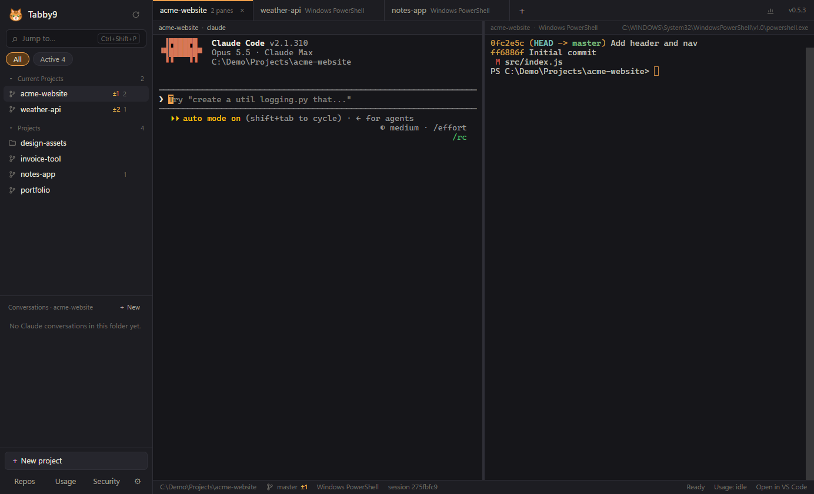
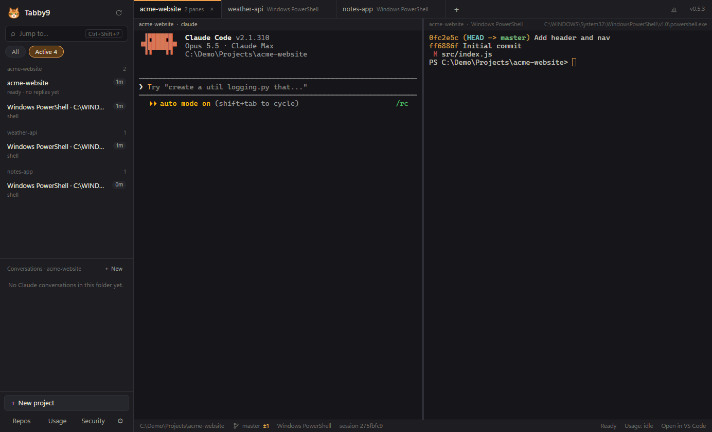
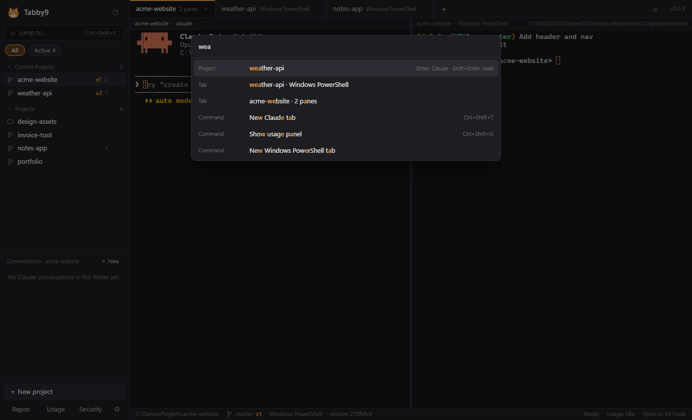
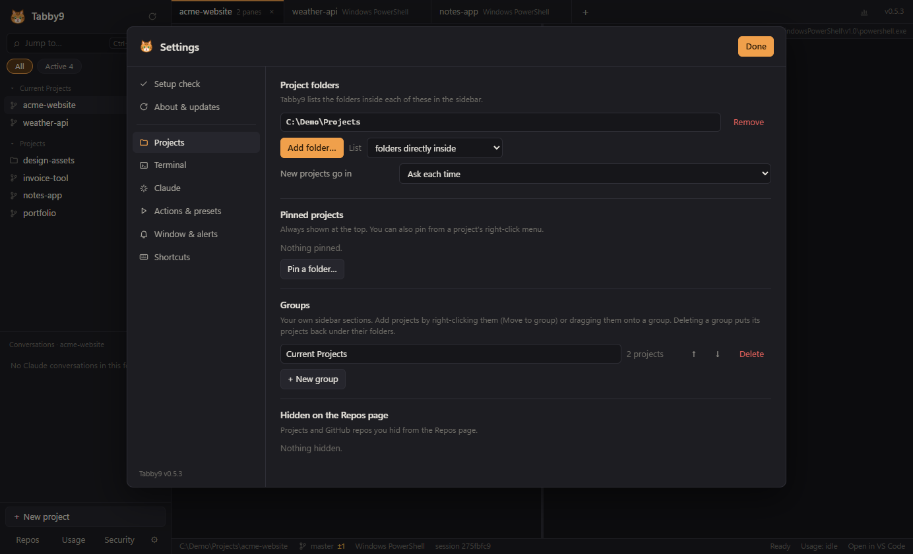

<h1 align="center">Tabby9</h1>

<b>Claude Code tabs with nine lives.</b> 
A Windows terminal built for Claude Code, where every tab and conversation comes back after a restart.

<a href="https://github.com/PurpleFusion/tabby9-releases/releases/latest"><b>Download the latest version</b></a> · <a href="https://purplefusion.com.au/tabby9/">Website</a>

## Why Tabby9

If you use Claude Code across several projects, restarting your computer usually means reopening every terminal, finding each folder again, and working out which conversation you were in. Tabby9 does that for you.

- **Tabs that survive a restart.** Every tab reopens in the same folder and shell, and Claude picks up the same conversation where you left off.
- **Your projects one click away.** Point Tabby9 at the folders where your projects live and it lists them all, with git status. Group them, pin them and put them in your own order.
- **Past conversations per project.** See every Claude conversation for a project, titled, and resume any of them.
- **Know when Claude needs you.** Status dots on tabs and projects, plus a notification when Claude is waiting for your approval or has finished, even in a tab you're not looking at.
- **Keep an eye on your limits.** See how much of your 5-hour window and week you've used, your pace, and which projects and conversations are using the most.
- **See what's running.** The Active view lists every running session, how long it's been going and how much context it's carrying. It also shows Claude sessions running outside Tabby9, so nothing is quietly using your limits. Start a conversation fresh with one click.
- **Built-in GitHub tools.** Start a new project with a private repo, see which projects need committing or pushing, and review Dependabot alerts across your repos. These use your existing GitHub CLI sign-in.
- **A proper terminal.** PowerShell, Command Prompt, Git Bash and WSL, split panes, and a command palette (Ctrl+Shift+P) to jump anywhere.

<table>
<tr>
<td> The Active view: what's running, and for how long</td>
<td> Jump to any project, tab or command</td>
</tr>
<tr>
<td colspan="2"> Settings: project folders, groups and more</td>
</tr>
</table>

## Install

1. Download `Tabby9-Setup-<version>.exe` from the [latest release](https://github.com/PurpleFusion/tabby9-releases/releases/latest) and run it. It installs for your Windows user, with no admin prompt.
2. The first time, Windows SmartScreen may say it "protected your PC", because Tabby9 isn't code-signed yet. Choose **More info → Run anyway**.
3. Tabby9 checks what's installed and asks where your projects live.

Tabby9 updates itself. New versions download in the background, and you choose when to restart; your tabs come back afterwards.

### What you need

- Windows 10 (version 1809 or later) or Windows 11
- [Claude Code](https://claude.com/claude-code) and [Git for Windows](https://git-scm.com)
- Optional: the [GitHub CLI](https://cli.github.com) for the GitHub features, and Python for dependency audits

## Privacy

Tabby9 runs on your computer. It reads Claude Code's own files and your project folders locally, and doesn't send analytics or any of your information to anyone. It only talks to GitHub to check for updates, and, when you use them, through your own GitHub and Claude sign-ins. Details are in the [privacy statement](PRIVACY.md), also at [purplefusion.com.au/privacy](https://purplefusion.com.au/privacy/).

## Support Tabby9 (opening soon)

Tabby9 is free, and it'll stay free. Sponsorship through GitHub Sponsors opens soon, once GitHub approves the page. It'll pay for new features, fixes and a code-signing certificate so Windows stops showing the SmartScreen warning on install. Until then, you can [follow PurpleFusion on GitHub](https://github.com/PurpleFusion).

Planned tiers: **Coffee** US$3/month · **Supporter** US$10/month, with your name in the app · **One-time** US$5.

Found a bug or have an idea? [Open an issue](https://github.com/PurpleFusion/tabby9-releases/issues).

## Licence

Tabby9 is free to use, for personal and commercial work, under the [Tabby9 licence](LICENSE.txt). It includes open-source software, listed in the app under Settings → About & updates → Legal.

© 2026 Vidos Consulting Pty Ltd. Tabby9 is an independent tool and isn't made or endorsed by Anthropic.
